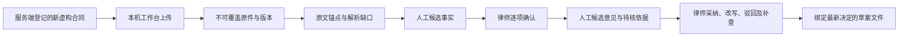

# 首轮辅助工作稿的数据流

用户已确认 CR-01。日常文件、原文核对、事实确认及下载入口继续使用本机工作台；最终 ChatGPT 薄插件复用同一后端，案件身份与文件桥尚未实现，不能把当前本机两工具当作完整 ChatGPT 审查能力。

这张图是已确认的目标数据流，各环节实际实施状态以 [ASSISTED_SCOPE](ASSISTED_SCOPE.md) 和阶段测试记录为准。人工候选接口收据明确没有实际模型推理；候选与确认分开，来源疑点在核对前不能进入确定计算。未核法源、没有覆盖的维度和外查未查询均保留在工作稿中。

|路径|当前范围与证据要求|
|---|---|
|工作台 → 本机服务/SQLite/文件存储|只登记独立虚构文件；复用真实会话、案件成员、CSRF、版本及不可变原件门|
|候选事实/意见 → 后端|人工输入，不传身份、批准或费用收据；后端核对当前原文位置、文件 hash、事实及上下文版本|
|原始意见 → 律师决定 → 草案|保留原始意见及全部处置历史；有效改文进入输出，驳回客户建议隐藏；旧成果不能继续当当前版本|
|后端 → DeepSeek / QCC / 云 OCR|关闭；真实请求、资料外传和扣费没有本轮授权|
|ChatGPT 宿主 → 案件服务|文件/身份桥与数据政策待落实；实际连接与宿主推理 NOT_RUN|

源包、SDK 子进程、本机宿主调用、ChatGPT 网页连接是分别记录的事实。源代码保存在本机不证明未来宿主推理的数据地域；未来调用前仍需确定账户、数据流和费用范围。本轮不据候选接口、工作稿确认或工程测试推定真实法源批准、法律准确率、正式签发或生产完成。
