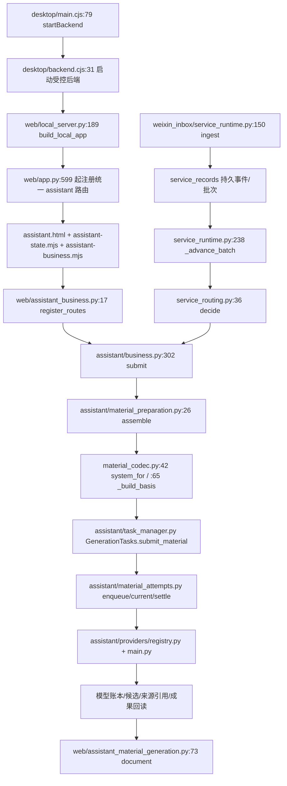

# 统一工作台阶段 0：当前架构与增量实施边界

2026-11-01，北京时间。依据当前磁盘源码核对；历史报告中的测试和安装结果不计入本轮。计划原件：`docs/plans/群兴工作台_Codex实施计划.md`。本阶段只读取产品，新增计划和盘点证据；未启动应用、读取生产数据库、运行模型或连接微信。

## 基线与保护

- 主仓库 `D:/Documents/ChatGPT/律所项目`，`codex/contract-review-v2`，HEAD `15acd84546616f8c44dc394e04bf7753cad72739`。桌面工作树 0.6.0，Python 包元数据仍 0.1.0；两者不是同一个版本字段。
- 开始时 18 个受跟踪文件变化，460 行增加、39 行删除；`docs/TASK_STATUS.md` 同时有已暂存和未暂存内容。不得整体重置、重新暂存或用 HEAD 覆盖。
- `.local/unified-plan-20261101/baseline/` 保存原始暂存/未暂存 binary diff、index 副本、状态、未跟踪清单以及 213 个既有变动/未跟踪文件的字节副本和 SHA-256。该目录不提交。阶段 0 结束核对 213 文件不变。
- 原计划 SHA-256 `cb44b31d42cd0e8e4cbd043541787672db2c4edd44dfe7ee035c79d3820e5111`，桌面原件保留。
- Python 3.12.14、Node v24.20.0、npm 11.19.0；Electron 44.8.0 / electron-builder 26.15.3 是包声明，未在阶段 0 启动验证。锁摘要及三仓文件摘要见 `docs/testing/unified-plan/20261101/phase0-inventory.json`。
- CodeGraph 1.6.2 已有索引，762 文件，pendingChanges 0；查询用于定位，源码和测试才是行为依据。

## 文件级入口与调用链

微信 `_execute_batch` 位于 `service_runtime.py:473`，复用材料主链，后台每批申请受控执行许可。旧独立接待使用 `reception/assistant.py` 和 `web/reception_assistant.py`；自动检索九份资料尚未接入 `material_preparation.assemble`。`material_codec.system_for` 仅选择本地提示词，庭审多角色文本不等于持衡独立回合。图是静态调用关系，不表示本轮端到端执行通过。

## 既有对象映射

| 目标语义 | 现有实现 | 后续复用边界 |
| --- | --- | --- |
| Conversation | `assistant/schema.py:6 assistant_conversations`、messages | 同一会话/权限范围，不另建聊天库 |
| Client / Case | `intake/schema.py:5 intake_cases`、intake_revisions；`persistence.py:71 matters` | 接待档案与案件身份不同，尚不能假定独立 Client 主表齐备 |
| Task | `business.py` 的 task_id、`task_drafts/schema.py:15 task_drafts` 和 task_executions | 业务任务与消息草稿的映射需保留，不机械新建同名表 |
| TaskBatch | `weixin_inbox/service_schema.py:22 weixin_service_batches` + batch_events | 批次事件序列和事项关联分别判断 |
| Material / Version | `persistence.py:88 document_versions`；assistant attachments / parses / material_snapshots | 原件、解析版本、来源哈希不可覆盖 |
| SkillInvocation | 目前为 business accepted/result 事件及 workflow；无完整第三方 Skill 调用清单 | 阶段 2 扩展现有记录，不以 UI 标签充当接入 |
| ModelRun | assistant_runs、主模型 attempts 与 usage 记录 | 沿用幂等、未知结果和费用账本 |
| Artifact | `persistence.py:142 exports`；assistant outputs / 材料输出 | 模型成果为内部草稿，客户可见稿结构化隔离尚待 |
| Permission / Approval | matter_memberships、approvals、native/模型逐次许可 | 后端核验；不把模型判断变成授权 |
| AuditEvent | `persistence.py:104 audit_events`、assistant_run_events、微信事件及 outbox | 原事件、来源和未知回执保留 |

DTO 继续只在 `src/cn_contract/domain.py` 定义。当前不是目标状态机全部已实现；例如微信使用 waiting/routed/executing/held 等实际状态，后续需要映射而非新增冲突枚举。

## 三仓版本及接入门槛

| 仓库 | 实际本地位置及版本 | 当前工作树 / 接入判断 |
| --- | --- | --- |
| 群兴 | 本文主仓，`15acd845...` | 以受保护的 0.6.0 工作树为修复基线，不能只用提交内容 |
| 持衡 | `.local/integrations/chiheng-legal-workbench`，`codex/windows-native-continuation`，`8a0d640bb58c82b909409a2e689a6cecd7f06058` | 无受跟踪改动；5 个 verification lock 未跟踪文件保留；不使用旧 main 替换 |
| 家事/通用办案 | `C:/Users/Administrator/Documents/Codex/2026-10-13/new-chat/outputs/songmeng-family-law-skill`，main，`65cabd5cf0641997fbed6441da47e63275e85b51` | 0.2.0 为未提交工作树，9 个受跟踪文件变化及新增 scripts/tests/2份资料；全文树摘要已记录，不能称该 commit 就是 0.2.0 |

持衡已读 HANDOFF、共享法库契约和第三方说明；原生构建和 625/7 等为历史证据，本轮未复跑。接口候选是 `mock_hearing.py` 的 create_session/load_session/hearing_progress/append_turn，法库复用 search_law/get_law_fragment/get_law_article；主仓尚无 `integrations/chiheng_adapter.py`。保持独立运行环境，不复制数据库。

家事 `THIRD_PARTY_NOTICES.md` 明确标识 AGPL-3.0，并说明没有单独上游许可文件/上游仓库地址、权利链未完成审查。本轮只读来源说明，不加载其正文为执行指令。依项目 AGENTS 与规格 0.5，该来源在批准前不得进入运行 prompt/rules/Skill；阶段 2 的首项接入存在真实阻断。

## 风险及阶段顺序

1. S1：`business.py:31` 否定词未包含“暂时不/不再”，桌面 JS 同类逻辑也需要一起修；泛化暂停、引用、条件和多事项要有反例。
2. S2：`service_routing.py:55–59` 续接仅看最后行，前一行仅少数完全匹配；需把续接和就绪分开，保留事件顺序与取消边界。
3. 家事来源许可未齐、0.2.0 未提交；禁止把工作树版本误标为已发布固定 commit。
4. 伙伴模型协议、数据保留/日志/部署能力未提供，阶段 3 不能虚构联调。
5. 九份接待资料属本机资料，本轮不复制或上传；阶段 2 需按既有私有知识授权和来源定位接线。
6. 阶段 0 之后仅做阶段 1 的小范围修复与合成验证。阶段 2 来源门槛未关闭时，不跳过顺序去做前端大改。真实微信/模型、安装、提交推送和发布均未获本轮授权。

阶段 0 完成：当前源码/环境/模型映射/三仓及改动保护已盘点。运行测试在阶段 1 单独计数。阶段 0 不构成生产、法律质量或真实业务验收。

## 盘点后的直接授权与阶段调整

本报告以上内容保留阶段 0 当时状态。用户随后提供 `https://github.com/Qiu-Shu/songmeng-family-law-skill`，确认项目由其研发、本机版本更新，并明确授权全部权限。家事本地运行接入阻断已解除，仍以 0.2.0 工作树为准，保留原作者、来源与许可；未把此次授权表述为对外分发法律审查完成。详见 `docs/plans/2026-11-01-family-source-check.md`。

后续以用户补充的六阶段顺序为准：阶段 2 能力接入、阶段 3 知识及数据、阶段 4 聊天前端、阶段 5 伙伴模型及微信、阶段 6 全链路验收。上文早期阶段编号不再用于安排执行。当前进度和本轮结果分别见 `docs/plans/2026-11-01-unified-progress.md` 与 `docs/testing/unified-plan/20261101/phase1-results.md`。
