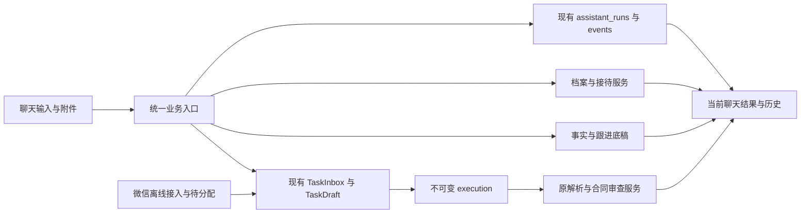

# 群兴统一入口 MVP 实施与验收

> 当前范围以 [2026-10-28 直接模型 MVP](2026-10-28-direct-model-mvp.md) 为准。本文保留本机 Mock 阶段的历史记录；其中逐项事实确认和逐次材料发送批准已被新版普通内部分析流程替代，已勾选项不代表新版真实模型验收完成。

日期：2026-10-26。依据：本聊天用户提供的《最小可用产品收敛与改造实施方案》，并明确要求盘点后顺序实施第 2、3 阶段。

## 第一阶段盘点

起点为 `codex/contract-review-v2`，HEAD 与远端只读查询均为 `be26d12fd993b20d096a5562809aad21ce096d03`。工作区已有合同评测未提交文件以及 AGENTS、TASK_STATUS 修改，全部保留，不能混入本轮提交。

| 要求 | 当前源码事实 | 本轮最小改造 |
|---|---|---|
| 一个聊天输入 | assistant.mjs 的 onSend 仅调 controller.send；assistant-state.mjs 分发普通生成/检索/法库上下文；技能生成被 GenerationTasks.submit 拒绝 | 增加轻量本地业务入口，沿用聊天输入和运行账本 |
| 合同同窗 | assistant-tasks.mjs:262–277 跳转 facts/review；TaskDraft bridge 已连接 ingest、candidate_parse、review | 保留桥接，事实核对和结果在对话内呈现 |
| 持久任务 | assistant_runs/events、TaskInbox、TaskDraft、execution 已存在 | 一张统一任务投影；业务结果写现有事件，禁止第二套任务库 |
| 销售端 | profile_store 原子保存档案/接待/回执；reception_worksheet 提供有来源追问；尚无跨客户实体匹配 | 复用当前明确关联的接待；新陈述保留来源，歧义询问，不凭同名归并 |
| 办案端 | evidence_worksheet/followup_worksheet 已有人工底稿、版本、来源和缺口；尚无自动材料整理入口 | 基于已登记材料和事实生成待核目录/时间线/争点/缺口 |
| 模拟法庭 | 当前仓库仅 workspace_nav 的“庭审辅助 待接入”，没有执行服务 | 轻量角色推演，复用当前事实与材料，结果保留依据和待核性质 |
| 微信 | 离线收件、去重、待分配、固定目标、历史代际已存在；TaskChannelBinding 限 synthetic | 共用收件和任务投影；真实账号及下载解密保持未验 |
| 模型 | 普通文字/profile/法库上下文有受控执行；TaskDraft bridge 仅 synthetic + Mock | 不把本地整理结果伪装真实模型结果，不扩大现有外发许可 |

禁止重复开发：不迁移 Electron/FastAPI/Jinja/静态 JS，不新建 CRM、合同库、消息队列、模型凭据库或多智能体平台；不引入 Harness²/MiroFish/OASIS；不删除旧审查接口和原件；不把 AI 推断保存为已核事实。

## 顺序实施

- [x] 第一阶段：源码、远端和工作区盘点。以上是源码结论，不是本轮运行验收。
- [x] 第二阶段的本机闭环：统一输入、自动读取 DOCX/PDF、任务结果、同窗事实确认与合成审查结果；源码浏览器已验证。材料 AI 与真实微信不在此完成项内。
- [x] 第三阶段（源码与虚构场景）：销售接待 → 办案整理 → 合同审查同窗 → 模拟法庭，逐项通过本地与 loopback 场景；真实外部账号另验。
- [x] 结束验证（源码范围）：目标 Python/JS、源版本/旧记录/恢复检查、独立审阅、实际界面检查、状态及证据更新。

## 接口与验证范围

后端在 `domain.py` 定义统一业务输入/结果 DTO，`assistant/business.py` 承担轻量调度与结果回读，`web/assistant_business.py` 只做已认证传输。结果复用不可变 `assistant_run_events`，不写入模型输出表。新增事件必须有完整性验证并接入备份校验。前端增加 `assistant-business.mjs`，由现有 composer 调用；保留中文输入、草稿冲突及未知请求找回。

首个可验证行为：虚构咨询在当前聊天保存一次接待结果，重复请求返回同一回执；跨会话、撤权和恢复副本拒写。随后验证材料分批、历史结果不变、明确重新开始、多候选询问、合同事实仍由人核对、法庭推演不声称裁判预测。测试位于现有 `tests/integration` 与 `scripts/test_assistant_*.mjs`，不使用真实合同或真实模型。

真实微信、律师法律质量和生产验收独立记录。恢复发布 WinError 5 与原生 AV 是既有未关闭事项，本轮不以其他检查通过关闭它们。

## 本轮追加决定：材料 AI 发送

用户明确选择逐次确认：展示选定材料、接收模型和费用，确认后发送；随后说明可考虑 WorkBuddy 与 DeepSeek，不以费用作为实现限制。本轮仍用虚构材料开发验证，不据此向模型发送真实合同。

独立设计复核已确认：普通文字、档案文字和法库片段的发送路径不能承担附件授权。新增 `material-business-v1` 专用格式，复用现有模型尝试/回执/输出账本、后台运行器、DeepSeek 传输及原生确认；不建立第二套模型服务。上传时 `external_processing=False` 的原记录保留，单次材料披露同意另行绑定材料原件摘要、解析版本、片段、发送字节、模型配置和任务归属。

材料 AI 的必要验收：取消零调用；跨会话/失效版本/篡改来源拒绝；超出容量明确提示而不静默截断；重复请求与并发 claim 只调用一次；发送未知只查原回执；撤权后丢弃候选但保留费用；旧文本/法库发送的附件禁发规则仍成立；真实备份往返与恢复禁写。模型生成的是带来源待核草稿，不自动确认事实、签发或对外发送。

2026-10-26 本机 WorkBuddy 状态读取：共享会话未连接、独立后台 sidecar 未就绪，因此先复用仓库已有 DeepSeek 链。此状态不能当成 WorkBuddy 产品不支持，也不证明 DeepSeek 实际账号已联调。

## WorkBuddy 接续收尾（2026-10-26）

材料 AI 源码链路已完成：静态模块与桌面打包清单补齐；授权自然到期、配置原地变化、claim 后材料选择变化均在发送前重新拒绝；传输边界同时复查内存授权、数据库材料版本和原件摘要。新增前端取消/双击/迟到授权/unknown 找回、原生逐次确认、HTTP 路由、实际并发 claim 和真实材料成果 qxbak 往返测试。独立 Spec 复核确认其三项发现均已闭环。

最终实测：目标 Python 153 项、前端 385 项、桌面 373 项全部通过；Chromium 四场景通过且零外部请求；schema、默认配置、来源和开发依赖门退出 0。真实 DeepSeek 远端、真实微信、安装版及律师法律质量仍未验收；未进行真实材料外发。
