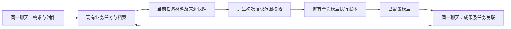

# 群兴工作台：直接模型闭环与当前范围

本轮实施依据是用户重新粘贴的《群兴法律工作台：最小可用产品收敛与改造实施方案（整理稿）》，以及本人个人微信、允许 GitHub 复用、允许 WorkBuddy 辅助的后续答复。整理稿优先于 2026-10-26 的本机 Mock 实施计划。此记录不修改锁定的历史规格或原始验收证据。

## M0：2026-10-28 当前基线与差距

基线分支 `codex/contract-review-v2`，HEAD `154ec10`（上一个业务实现提交 `8682990`）。读取过当前未提交更改；产品界面、0.5.1 打包和合同模型对比由其他进行中的工作更新，保留，不混入本轮业务改动。

| 新要求 | 当前事实与处理 |
| --- | --- |
| 内部分析不逐项审核 | 原合同 TaskDraft Mock 路径仍需事实确认；保留历史功能，不作为新主流程。直接模型分析使用有来源的待核材料，不自动改为已确认。 |
| 首次设置后自动模型调用 | 已有材料模型执行、单次授权与不可变执行记录，但独立按钮和逐次原生弹窗割裂流程。增加原生初次授权范围，复用现有单次后台校验；范围外仍明确提示。 |
| 统一发送直接得到结果 | 现 business.send 仅本地整理。串联同一已确认业务回执与材料执行；不新增任务数据库或第二套模型连接。 |
| 连续补充、追问 | 已有材料版本与 task_id；需核验追问上下文、分批材料和未知回执，不能仅靠当前一句话分析。 |
| 四能力真实成果 | 本地销售/办案/庭审整理不算真实生成验收。依次验证实际客户回复、起诉状草稿、合同修改建议、三角色推演。 |
| 本人个人微信 | 当前账户及协议接入限 synthetic；官方 iLink 适配研究独立记录，真实扫码/文字/附件/回传尚未通过。 |
| 已安装产品验收 | 本轮已验证 0.5.1 解包程序旧回归 15 项及统一业务 6 组，均为虚构材料和 Mock，不代表直接模型或安装升级验收。 |

替代的旧要求：普通内部分析的逐项事实确认、每次模型发送审批、必须先运行 Mock 的主流程。保留：账号与案件权限、选定材料范围、来源及待核状态、原件不可覆盖、模型和版本绑定、费用及单次调用上限、未知回执只查询、取消与撤权、明确授权的外部发送。停止扩展备份/恢复产品、复杂审批和多级签发。

禁止重复开发：新 CRM、合同库、任务库、消息队列、模型凭据库、合同解析引擎、多智能体平台；不以引入 Harness²/MiroFish 为前置条件；不把真实微信缺失说成离线验证已完成。

## 实施与验收顺序

- [x] M0：读取更新和新版范围，记录差距与旧要求替代关系。
- [x] M1/M2 源码工程闭环：初次原生模型设置授权当前任务选定材料；聊天发送自动串联业务回执和模型执行；虚构 DOCX +「我是甲方，帮我审查并给出最小修改建议」实际模型完成，当前聊天回读。后续修复以离线回归复核；用户安装单列。
- [x] M3 最小源码闭环：材料与成果关联、补充和追问复用、原件与历史执行保持；连续接待沿既有档案补充并保留原话及明确更正，人工修改不被自动覆盖。23 项接待边界回归通过；未扩展大型 CRM 或跨客户猜测匹配。
- [x] M4/M5 源码工程场景：销售、办案文书、有限庭审角色分别真实模型验收；这不是律师法律质量批准。
- [ ] M6：独立本人微信扫码、真实文字、虚构附件下载解密及固定回复收到已完成；接入既有任务归集和业务成果回传仍待实施。[真实通道证据](../testing/personal-weixin-live/20261028/README.md)。
- [ ] M7 完整场景：已原地更新为 0.5.1，651 个安装文件一致，既有 83 文件安装时未改，首次启动后旧表行及保护资料保留；安装程序 5 个模型历史成果和 Word 回读通过。真实微信场景仍待 M6，不将源码模型实测冒充安装后新发送。

验证先写针对故障的失败测试，再跑所改调用链的回归；真实模型仅使用独立虚构样本。凭据继续由原生安全存储处理，不读入日志、不提交。其他任务的合同模型对比与费用账本不替代本项完整产品验收。

WorkBuddy 已在独立工程会话完成只读复核（桥接确认模型 DeepSeek V4 Pro），指出 business 本地结果与 material generation 的断点。它提供建议，实施及最终验收由本任务复核；这不等于工作台已经集成 WorkBuddy 模型服务。

M3 最小源码场景已完成同任务历史、分批材料与成果引用、停止、明确归属以及接待档案连续更新。多业务任务有歧义时仍需用户明确；不凭时间猜测。M6 本人已确认助手会话入口并完成真实扫码、文字及指定虚构文件收发测试；成功码和附件默认字段省略的两处兼容问题已修复。网络发送回执保留 unknown，另记录用户确认收到，不重复发送；下一片再接既有任务机制。[统一模型证据](../testing/direct-model-mvp/20261028/README.md)与[真实微信证据](../testing/personal-weixin-live/20261028/README.md)。
