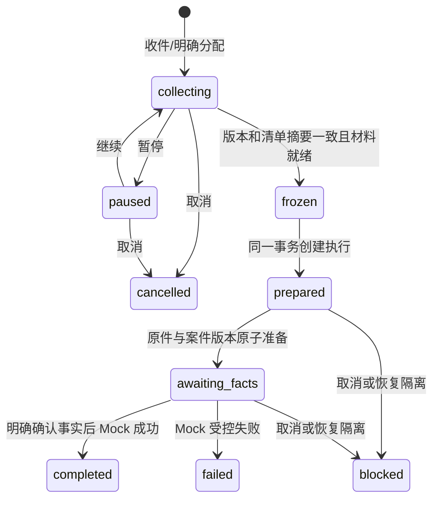

# 持久合同任务 A＋B：实现与验收

日期：2026-10-24。工作区：`D:\Documents\ChatGPT\律所项目`。沿 `codex/contract-review-v2`，基线 `f9e6bf45e78a58ff094fa21b8dcc47fd465fb227`；开始时工作区干净。当前记录仅对应源码和独立虚构材料，安装版仍为 0.4.1。

## 本片行为

对话页“审查合同 · 模拟”已接到独立任务卡。可以先填指令、后分次收集附件，也可先收附件再补指令；收集不会创建 assistant run。任务可暂停、继续、取消，歧义或满额事件完整保留为待分配。材料冻结固定版本和摘要；后来补充进入子草稿，不修改原执行。

准备阶段把已登记的合成 DOCX 复制为目标空合成案件的不可变原件/文档版本，复用现有解析与事实候选。用户必须在原有事实确认页明确处理事实，再返回任务运行 Mock 内部审查。正常桌面仍使用 assisted_draft：任务通过持久 execution_id、当前归属、案件权限、合成策略、登记哈希、原件及解析版本重核获得本地 Mock 准入，普通 assisted 审查入口不因此放开。

每次准备和结果映射在现有事务内提交；重复请求只返回既有结果。当前阶段是有界、同步、本地 Mock，没有后台真实模型调用；不承诺外部系统 exactly-once。恢复副本保留历史并阻断所有接收和执行，历史读取不等于当前批准。

## 代码与证据入口

| 范围 | 实现入口 | 本轮证据 |
| --- | --- | --- |
| DTO、Inbox、关联和 TaskDraft 状态 | `src/cn_contract/domain.py`；`task_drafts/service.py`、`schema.py` | [核心红绿](core.md) |
| DOCX、案件、事实及 Mock 结果桥接 | `task_drafts/bridge.py`、`mock_policy.py`；`web/services.py`；`review/workflow.py` | [独立桥接复核](bridge-review.md) |
| 迁移、备份、恢复与来源完整性 | `storage_schema.py`、`schema_migrations.py`；`task_drafts/integrity.py`；`ops/backup.py`、`workspace_backup.py` | [存储红绿和真实备份往返](storage.md) |
| HTTP、任务卡及统一列表 | `web/task_drafts.py`、`intake.py`、`recovery.py`；`web/static/assistant-tasks.mjs` | [界面与路由红绿](ui.md) |
| WorkBuddy Kimi-K3 协作 | 已核实原生 ACP 模型 `kimi-k3-2` | [反馈核验及处置](workbuddy.md) |
| 浏览器可复验脚本 | `scripts/validate_task_drafts_browser.py` | 下文实际执行记录 |

## 当前调用定位（本片源码行号）

| 链路 | 符号与位置 | 对应证据 |
| --- | --- | --- |
| 登录、会话与案件权限 | `security.py:67 login`、`:92 authenticate`、`:143 authorize`；`assistant/service.py:61 _owned` | 任务 HTTP 及独立撤权探针 |
| 原件及解析 | `assistant/attachments.py:108 ingest_attachment`、`:211 parse_attachment` | 既有附件回归、两种浏览器顺序 |
| 合成绑定与事务收件 | `task_drafts/service.py:38 create_binding`、`:319 receive_batch` | `test_task_drafts.py` |
| 冻结及执行恢复 | `task_drafts/service.py:416 freeze_draft`、`:168 read_execution` | 版本冲突、后补子草稿及重读测试 |
| 案件材料桥接 | `task_drafts/bridge.py:51 prepare_execution` | `test_task_drafts_bridge.py` |
| 人工事实确认后的 Mock | `task_drafts/bridge.py:84 review_execution`；`review/workflow.py:296 run_review` | native HTTP、浏览器、桥接独立探针 |
| 本地模拟准入及结果重核 | `task_drafts/mock_policy.py:62 require_mock_execution`；`review/workflow.py:41 current_manifest` | 伪 ID/provider、撤权、注册撤销、原件篡改探针 |
| 备份来源和恢复围栏 | `task_drafts/integrity.py:204 validate_task_records`；`ops/workspace_backup.py:303 _fence`；`task_drafts/service.py:498 quarantine_executions` | 迁移/篡改拒绝、完成成果双往返 |
| 恢复历史页 | `web/recovery.py:22 attach_recovery` 注册 `/recovery/task-executions/{identifier}` | 历史只读页面、当前权限及禁写 HTTP |

以上路径均相对 `src/cn_contract`；测试文件位于 `tests/integration`。行号来自本片最终源码实际 rg 查询，不能作为未来版本的位置保证。既有真实模型原生许可、费用账本和外发路径没有在本片被接入或改成自动批准。

## 状态机及权限边界

执行内部还有 creating_matter/running 状态，与业务写入同事务。queued 是未来调度保留值，本片未启用外部队列。取消草稿不能直接恢复；冻结任务的后补材料生成关联子草稿。暂停或取消中的普通收件保留为待分配，并明确显示回执；它不触发任务恢复。

所有权由服务器会话重读，显式任务号/回复引用只在同绑定内有效；多个可能目标不会按时间猜测。工作区身份、会话绑定修订和案件成员权限每次核验。HTTP 在读请求体前后复核认证和 CSRF；撤权后前端清空敏感任务显示。原始事件、媒体处理历史和冻结清单不可覆盖；材料用途和当前登记来源在准备、执行及实时结果读取时再次校验。

## 端到端验收矩阵

以下 PASS 仅为本轮源码合成验证，详细命令、数量和失败过程见对应证据。

| 场景 | 实际状态与证据 |
| --- | --- |
| 指令先到、文件先到、多个消息/附件完整落库 | PASS：核心、HTTP；两种顺序均实际 Chromium 完整闭环 |
| 同事件重放、相同 ID 不同内容、并发同批 | PASS：核心 |
| 回复关联、未知回复、多候选歧义 | PASS：核心 |
| 显式满额草稿保留整批原事件、游标及待分配项 | PASS：WorkBuddy 提出、有效 RED 后核心回归 |
| 暂停/继续/取消，不重复创建模型任务 | PASS：核心、HTTP、前端 |
| 未读媒体阻断、主合同选择、更新读取引用、排除/恢复留痕 | PASS：核心、HTTP、前端 |
| 旧版本/旧清单摘要冻结被拒；冻结后补充不改变原执行 | PASS：核心、备份完整性 |
| 撤权、跨会话、跨案件、过期会话及 CSRF | PASS：核心、HTTP、独立桥接探针 |
| 原件篡改、登记撤销、local 材料冒充合成 | PASS：独立桥接及 native HTTP |
| DOCX 准备失败不残留部分版本；同 hash 不同附件保持不同映射 | PASS：桥接回滚、独立探针 |
| 事实未确认不能审查；明确确认后恰好保存一次 Mock 结果 | PASS：桥接、HTTP、浏览器 |
| 正常桌面 assisted 模式可走限定合成链，普通审查仍阻断 | PASS：native HTTP、Chromium、独立准入探针 |
| 旧版 schema 指纹、迁移失败回滚、认证但损坏的备份拒绝 | PASS：存储目标回归；广泛兼容结果另列 |
| 完整成果 .qxbak 两代往返、媒体历史与原件保留、零重放 | PASS：独立完成成果往返测试，10 次写入尝试均阻断 |
| 工作区统一显示任务、会话切换旧响应隔离、刷新恢复 | PASS：HTTP、前端、Chromium |
| 恢复副本历史成果页面、当前权限拒绝、所有写仍关闭 | PASS：历史页 HTTP、前端；实时 current=True 保持阻断 |
| PDF 合同任务桥接 | 尚未实现；NOT_RUN |
| 官方真实微信账号、实际外部 cursor/重连、客户端发送回执 | 尚未接入；NOT_RUN |
| 真实模型、收费、原生限期授权与真实合同法律质量 | 本片未启用；NOT_RUN |
| 新安装器、冻结后端、已安装 Electron 窗口及生产升级 | NOT_RUN；不把源码浏览器和桌面单元测试当成安装验收 |
| 全仓完整 Python 套件、既有 WIN-PATH-02 完整关闭 | NOT_RUN；未将既有开放项标为修复 |

## 根任务执行账本

最终功能关联回归：20 文件、382 个不同用例，0 failed/error/skipped。4 个独立完整模块67项通过，其余315项分40个独立进程短组（每组最多8项）全部通过；每个子进程实际退出0，JUnit与节点集合去重核验一致。不是一次完整单进程或全仓运行。最初18文件长进程因 Windows 原生访问冲突退出，未取得完整统计；精确崩溃用例单独通过，长进程稳定性尚未关闭，见 [诊断记录](native-crash.md)。

广泛存储回归：27 个文件，731 项，实际退出码 1，675 passed / 56 failed / 1 warning，1364.94 秒；原始失败保留。55 项来自旧版升级夹具遗漏本片新表，剩余 1 项来自旧“升级到当前版本”新增表精确集合尚未包含任务表。旧夹具修正后完整 `test_workspace_upgrade.py` 58 passed，退出码 0；精确集合补修后完整 `test_assistant_library_schema.py` 38 passed，退出码 0。没有改产品 schema 识别或旧结构指纹，也不将原731项记录改写为一次全通过。已用JUnit的 classname/name逐项比对：原56个失败节点全部包含在修正后58＋38项完整复验的通过集合中。

短组及模块的通用命令为 `.venv/Scripts/python.exe -B -X utf8 -m pytest -q -p no:cacheprovider <完整模块或最多8个具体nodeid> --tb=short --basetemp <独立临时目录> --junitxml <独立回执>`。节点列表、每次命令、原始退出码和JUnit保存于 `.local/task-drafts-20261024/verification/checkpoints/`；完整模块回执在 `isolated-final/`。中断的旧尝试未计入，完成的节点未重复计数。

| 本轮功能回归文件 | 实际通过项 |
| --- | --- |
| `test_task_drafts_migration.py` | 74 |
| `test_review_flow.py` | 50 |
| `test_assisted_review.py` | 41 |
| `test_assisted_confirmation.py` | 19 |
| `test_finding_basis_review.py` | 18 |
| `test_effective_text_review.py` | 14 |
| `test_api.py` | 16 |
| `test_api_controls.py` | 11 |
| `test_api_query_jobs.py` | 5 |
| `test_api_replay_current.py` | 2 |
| `test_api_job_outcomes.py` | 3 |
| `test_assistant_attachments.py` | 14 |
| `test_assistant_attachment_routes.py` | 18 |
| `test_assistant_attachment_formats.py` | 5 |
| `test_task_drafts_bridge_review.py` | 24 |
| `test_task_drafts_completed_backup.py` | 1 |
| `test_assistant_frontend.py` | 11 |
| `test_task_drafts.py` | 32 |
| `test_task_drafts_bridge.py` | 12 |
| `test_task_draft_routes.py` | 12 |

33份变更/新增产品文件在源码摘要快照后没有漂移；`.local/task-drafts-20261024/verification/source-snapshot.json` SHA256为 `284cf4b8059f3450f539a27e7fdeb10742443d45a8ae330c7044b65396c622f0`。汇总机读回执为同目录 `final-results.json`，没有把临时数据库、截图或原始日志纳入Git。各证据页中的重叠运行数量不跨次累计。

已完成：`node --test scripts/test_assistant_*.mjs` 最终 161 passed，0 failed，退出码 0；`desktop` 中 `node --test tests/*.test.cjs` 366 passed，退出码 0。四开发门（schema --check、verify_defaults、verify_sources --mode development、verify_runtime_dependencies --mode development）均退出 0；13 来源仍有已知 NOT_PRODUCTION_APPROVED 提示，55 包/1 构建包验证并不代表原生包已验收，network_calls=0。

最终浏览器命令：`.venv/Scripts/python.exe -B -X utf8 scripts/validate_task_drafts_browser.py --assisted --order <instruction-first|material-first> --output .local/task-drafts-20261024/native-browser-final-<order>`。两个独立运行均退出码 0，分别完成 6/7 个实际步骤。WorkBuddy 实现顺序参数，Codex 复核并实际执行；有效脚本操作失败及修正见 [协作记录](workbuddy.md)。

上传及解析经真实页面控件，使用项目登记的 assisted-v1/sales-01.docx；人工确认动作由验收脚本仅对独立虚构事实执行。数据库为临时新建，不读取用户运行库。

两种顺序各自结果：2 条 inbox、1 草稿、1 执行、1 文档版本、1 review、0 assistant run；页面异常 0、外部浏览器请求 0，840 宽视口无横向溢出。已人工查看完成截图。两份临时数据库的 native 结构及共享来源完整性检查通过，各 2 个受保护文件引用；初次误用非原生 schema 预期被拒，改用实际 native schema 后通过，未更改验证逻辑。

临时截图、报告、数据库和原始终端日志留在 `.local/task-drafts-20261024`，不纳入 Git。本轮未修改依赖/配置、未安装机器人、未连接微信、未用真实合同调用产品模型、未对外发送文书。

## A—E 接续

| 阶段 | 当前状态 | 下一步及边界 |
| --- | --- | --- |
| A 持久收件及 TaskDraft | 本片已实现并执行合成验证 | 真实通道接入时继续保留完整批次、事件去重和明确关联语义 |
| B DOCX 离线内部闭环 | 本片已实现并执行合成验证 | 当前只接服务器登记的合成 DOCX，人工事实确认不省略 |
| C PDF 桥接 | 尚未实现，NOT_RUN | 复用已有合同侧 PDF 解析；映射页面锚点，明确扫描件/未读范围；不自动加入新 OCR 依赖 |
| D 官方微信 | 尚未实现，NOT_RUN | 在已核查上游版本基础上固定适配层、桌面可信账号绑定和权限；仅最小状态回执，连接实际账号需独立操作授权 |
| E 真实合同模型及限期授权 | 尚未实现，NOT_RUN | 复用既有原生批准、预算和请求账本；未知结果只找回，撤权立即阻断；法律结论与外发仍须律师明确决定 |

无人值守指开发过程自主推进，不等于替用户确认业务事实、签发法律意见或授权外部账号和收费。

前一实施轮实现及合成验收收口时，改动留在工作区且未提交/推送。用户随后明确要求与 GitHub 同步，产品提交 `0178859b19457ff67543af66bb20c1863148b404` 已正常同步并独立核验远端，SHA、tree 及递归 4,992 个受控条目一致；详见[同步回执](github-sync.md)。Windows 长进程原生崩溃已补充事件/转储元数据及两个未复现的紧密探针，根因仍未定位，不能据短组通过宣布修复；安装版、真实微信/合同/产品模型及生产状态仍以本页 NOT_RUN 边界为准。
